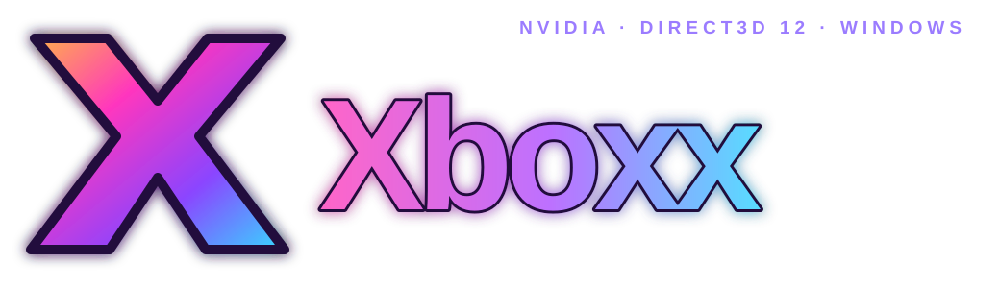

<div align="center">



### NVIDIA RTX 5060 · WINDOWS x64 · DIRECT3D 12

**Xboxx — a community compatibility project focused on NVIDIA support, GPU diagnostics and lower CPU overhead.**


[Quick start](#-quick-start) · [RTX 5060 status](#-rtx-5060-status) · [Optimisations](#-cpu--pipeline-optimisations) · [Testing](#-build--validation) · [Credits](#-credits)

</div>

---

> [!IMPORTANT]
> **RTX 5060 compatibility and playable performance are not yet demonstrated.**
> The project has automated Windows CI coverage, but CI does not run on a physical RTX 5060. No FPS, frame-time or VRAM improvement is claimed without measurements from real hardware.

## ✦ Project overview

Xboxx is based on [VIctory](https://github.com/Marvisak/VIctory), a compatibility layer for running an Xbox Series title on Windows from files supplied by the user.

This fork concentrates on:

- NVIDIA GeForce support and accurate adapter/capability diagnostics.
- Direct3D 12 and shader-path compatibility.
- Memory-conscious behaviour for GPUs with 8 GB of VRAM.
- Reducing avoidable CPU-side contention in pipeline loading and diagnostics.
- Reproducible Windows builds, automated regression tests and a simpler test launcher.

The work is experimental. It does not turn every Xbox title into a working Windows game, and this repository does not include game files or copyrighted game assets.

## ◈ RTX 5060 status

| Area | Current status |
|---|---|
| Host graphics API | Direct3D 12 |
| Adapter discovery | Generic DXGI selection with startup diagnostics |
| NVIDIA RDNA translation path | Explicitly disabled; AMD-only path remains gated |
| NVIDIA RTX 5060 runtime | Not yet validated on physical hardware |
| 8 GB VRAM policy | Regression-tested thresholds; not yet tuned from RTX 5060 measurements |
| Windows x64 build | Automated package workflow available |
| Real game performance | No RTX 5060 FPS/frame-time result published |

### Hardware evidence — keep the results separate

The inherited VIctory reference measurements were collected on an Intel Core i9-12900K, 64 GB RAM and a Radeon RX 7900 XTX (24 GB VRAM), with ray tracing disabled. They are **not RTX 5060 results**.

| Reference scene / configuration | Reported result |
|---|---:|
| City street, Series S profile, patches 1, 2, 5, 6 and 7 | ~44.9 ms/frame (~22 FPS) |
| Same scene, patches 1, 2, 5 and 6 | 45.6 ms/frame, p95 47 ms |
| Same scene, patches 1, 2 and 5 | 47.3 ms/frame, p95 49 ms |
| Series X profile, patches 1 and 2 | ~53 ms/frame (~19 FPS) |

An inherited RTX 3090 report showed partial execution at approximately 0.53–0.55 seconds per frame. That does not establish RTX 5060 compatibility.

## ◈ DLSS status

| Component | Current status |
|---|---|
| Host Direct3D 12 swap chain | Implemented in the host presenter |
| Current presentation | Copies the guest output texture, or composites the Series S planes, into the swap-chain back buffer |
| Streamline SDK | Not integrated |
| DLSS Super Resolution | Not active; no DLSS output is claimed |
| Depth resources | Guest draw state records render-target and DSV bindings; binding-time compatibility checks and exact color/depth candidate matching by guest resource identity and present frame are implemented; DLSS evaluation is not yet wired |
| Motion vectors and jitter | CPU-side metadata contract validates extent, finite scale/jitter, explicit units/direction and previous-frame validity; renderer data is not wired |
| Temporal history lifecycle | A CPU-side frame plan now pairs frame index, render extent, history reset/validity and deterministic Halton(2,3) jitter; projection application, motion vectors and GPU history remain unwired |
| DLSS evaluation preflight | CPU-side gate checks frame/jitter/history, compatible color/depth, matching 2D motion vectors, single-sample non-array inputs and resources that permit shader-resource views, distinct resources and completed-submission transition proposals; it does not issue barriers or call Streamline |
| DLSS output allocation policy | Windows host now samples the live DXGI local-memory budget (`Budget - CurrentUsage`) before allocating, reuses an identical target, and refuses new allocation if the budget is unavailable or below the 25%-headroom estimate; driver residency and allocation can still fail |
| DLSS output target | Validated output descriptors and a Windows D3D12 allocator now create a dedicated default-heap 2D UAV texture in `COMMON`; the allocator is not yet called by the presenter or Streamline, and GPU barriers/evaluation remain unwired |
| Safe fallback | Normal presentation remains unchanged if `VICTORY_DLSS` is requested |

The host swap chain already exists; the missing work is the temporal upscaling path, not basic window presentation. The output contract now also validates that the dedicated output resource's tracked source state is known and that the exact recording-list submission has completed before proposing the UAV state; this remains a CPU-only proposal and records no barrier. A Windows-only host allocator can now create a dedicated default-heap 2D UAV texture for the three supported output formats (RGBA8, RGB10A2 and RGBA16F), with single-sample dimensions validated up to D3D12's 16,384-pixel texture limit and an estimated allocation size. The resource starts in `COMMON` and is returned with an owning COM reference. The current presenter does not call this allocator yet, so it does not allocate unused VRAM or imply that an evaluation path exists. The evaluation contract now also requires a dedicated output texture at the requested final resolution with UAV capability; the swap-chain back buffer is not assumed to be a valid DLSS output target. The current presenter receives the finished guest texture and copies it to the back buffer. The guest draw layer already tracks render-target and depth-stencil bindings and now rejects incompatible color/depth pairs at binding time (extent, sample count and typed DSV format). The draw layer now retains compatible candidate pairs by guest color-resource identity and upcoming present frame. The presenter consumes a candidate only when that exact color resource is presented with the matching host-present serial; ambiguous pairs are rejected and host resources are retained through the presentation call. Seven unit tests cover exact identity, serial mismatch, conflicting pairs, sticky invalidation, stale-entry pruning, exact recording-list submission association and fence-completion gating. Each candidate is now tied to the host command-list identity that recorded it, assigned the host submission token when that exact list is submitted, and rejected at presentation unless the token has completed after the queue fence wait. The additional global quiescence check remains. At candidate consumption, the current `HostTexture.state` values are sampled and conservatively classified. The diagnostic now distinguishes PIXEL/NON_PIXEL shader-resource-readable states from other read-only states and flags write/read mixtures or unknown bits. These flags are not a synchronization proof, do not emit D3D12 barriers, do not account for every cross-queue transition, and do not prove that the candidate pair corresponds to the final color contents. A new CPU-only transition preflight now checks non-null resource/list identity, exact recording-list match, completed submission token, known source state and a valid shader-read target before producing a barrier proposal; it still emits no D3D12 command. No DLSS pass consumes the depth resource yet. A temporal metadata validator now rejects mismatched motion-vector extents, zero/non-finite vector scales, non-finite pixel-space jitter and invalid previous-frame history, while requiring the renderer to state vector units and direction explicitly. It does not generate or verify actual per-pixel vectors, apply projection jitter or provide history textures. A separate CPU-side history tracker now invalidates temporal continuity on first frame, render-size changes, camera cuts, explicit resets and non-consecutive frame indices; it does not allocate or validate GPU history textures. A deterministic Halton(2,3) generator now supplies centered sub-pixel jitter offsets in render-pixel units. A new CPU-side `TemporalFramePlan` combines the frame index, render extent, matching jitter sample and history-validity/reset decision, preventing those pieces of metadata from drifting across frame indices. It still does not apply jitter to the guest projection matrix, generate motion vectors or allocate GPU history textures. A unified `plan_dlss_evaluation` gate now assembles the future frame contract: required inputs, matching render/output extents, the exact frame's jitter and valid history, distinct color/depth/motion-vector resources, and completed-submission shader-read transition proposals. It remains a CPU-only preflight and does not record barriers or invoke Streamline. It now also requires texture metadata for the exact frame: color/depth must pass the 2D extent, sample-count and typed depth-format check, motion vectors must match the render extent, all inputs must be single-sample, texture arrays are rejected until explicit slice-view selection is implemented, and resources carrying `D3D12_RESOURCE_FLAG_DENY_SHADER_RESOURCE` are rejected because Streamline cannot sample them through an SRV. This validates declared metadata only; it does not prove that the textures contain valid scene data or that their GPU states are synchronized.

A preflight module now defines the required input contract, quality names and output-resolution planning, caches the requested state once per process, emits a single warning rather than spamming every frame, and explicitly reports DLSS as unavailable. Setting `VICTORY_DLSS=1` currently produces a warning and keeps normal presentation; it does **not** enable DLSS. `VICTORY_DLSS_QUALITY` accepts `quality`, `balanced`, `performance` or `ultra-performance` for future integration work only.

See [docs/dlss-integration-status.md](docs/dlss-integration-status.md) for the remaining Streamline and renderer work, including the limits of the current present-serial association. Do not treat this groundwork as a working DLSS implementation or as an RTX 5060 hardware test.

## ✦ CPU & pipeline optimisations

Recent work targets CPU overhead around the host pipeline library and diagnostics:

| Component | Change |
|---|---|
| Pipeline load guards | 256 digest-selected lock stripes instead of 64 |
| Pipeline-call diagnostics | 64 thread-ID-sharded tracking locks instead of one global lock |
| Diagnostic call removal | `swap_remove` avoids shifting the remaining vector entries |
| Early-pipeline tracking | 64 digest-selected shards with an atomic global limit of 100,000 keys |
| Early-pipeline key storage | 128-bit BLAKE3 prefixes stored as `u128`, rather than individually allocated strings |
| Conversion cache publication | Concurrent writers cannot turn a valid cache hit into a Windows rename failure; the first complete entry is retained |
| Shader cache keys | The translator build fingerprint is hashed as a separate prefix, avoiding a full copy of each shader container before cache lookup |
| Texture upload scheduling | Pending ahead-of-list uploads are indexed by host-copy serial for constant-time lookup and removal instead of repeated linear scans |
| Upload worker batches | Each long-lived copy worker reuses its batch vector capacity instead of allocating and freeing a new vector for every submission |
| Upload arena allocation | Reserved blocks are marked under the allocator lock, then zeroed after releasing it so large uploads do not serialize unrelated arena allocations |
| Upload arena search | A per-arena cursor starts first-fit searches near the previous allocation and moves backward when blocks are freed, avoiding repeated scans from the beginning in common reuse patterns |
| Upload arena capacity | A free-block counter skips arenas that cannot satisfy a request before scanning their allocation bitmap; allocation and release update the count together with the bitmap |
| Persistence | Existing 32-character hexadecimal `early-pipelines.txt` format retained |

These changes reduce specific sources of lock contention and allocation overhead. They do **not** prove higher FPS or lower frame times; those effects require controlled measurements on the target GPU.

## ◈ Quick start

### Option A — one-click Windows launcher

1. Download the latest available `VIctory-RTX5060-Windows-x64` artifact (the executable package keeps its original technical filename) from the [GitHub Actions runs](https://github.com/valouddsite/VIctory-Belobug-Nvidia/actions).
2. Extract the ZIP to a writable folder.
3. Double-click `VIctory-Launcher.cmd`.
4. Select your own game executable.
5. Choose the normal or safe profile.
6. Read the generated log in `logs/` if startup fails.

The launcher creates `victory.toml` from the example configuration when needed. The selected game directory is passed only to that launch session. PowerShell's temporary execution-policy bypass is scoped to the launcher process; it does not change the machine-wide or user-wide policy.

### Option B — manual launch

Requirements:

- Windows 10/11 x64.
- An AVX2-capable CPU.
- A Direct3D 12 GPU with Shader Model 6.6 and mesh-shader support.
- The pinned Rust toolchain and Visual Studio C++ build tools when building from source.
- Your own legally obtained game files.

Build and launch:

```powershell
git clone https://github.com/valouddsite/VIctory-Belobug-Nvidia
cd VIctory-Belobug-Nvidia
Copy-Item victory.example.toml victory.toml
# Edit victory.toml and set your own paths.
cargo build --locked --profile diag -p victory --features diagnostics
.scriptsplay.ps1 -Exe "D:\path\to\your\game.exe"
```

For advanced options, see [docs/rtx-5060-test-release.md](docs/rtx-5060-test-release.md).

## ⬡ Windows test package

The [Windows test package workflow](https://github.com/valouddsite/VIctory-Belobug-Nvidia/actions/workflows/windows-test-package.yml) builds a Windows x64 ZIP containing:

- `victory.exe`
- `victory.example.toml`
- `VIctory-Launcher.cmd`
- PowerShell launch scripts
- `TEST-ON-YOUR-PC.txt`

GitHub Actions artifacts are temporary and expire according to the retention period configured in the workflow. A successful CI build verifies compilation and automated tests only; it is not a GPU hardware certification.

## ◈ Renderer switches

The following experimental renderer patches are opt-in while they are being tested:

| Variable | Purpose |
|---|---|
| `VICTORY_PORT_CONSTANTS=1` | Read the title's constants heap directly on the GPU |
| `VICTORY_PORT_DESCRIPTORS=1` | Track descriptor-table writes rather than scanning the full table |
| `VICTORY_PORT_CBV=1` | Read translated-shader constant buffers in place |
| `VICTORY_PORT_GUARD=1` | Split write-guard work across 64 KiB blocks |
| `VICTORY_PORT_JOURNAL=1` | Shard heap journal records and reduce submission-thread waits |

Do not enable experimental switches blindly. Change one variable at a time and keep the logs and exact configuration for comparison.

## ⌘ Build & validation

The Windows CI pipeline checks:

- `cargo test --workspace --locked -- --test-threads=1`
- `cargo test --workspace --all-features --locked -- --test-threads=1`
- Clippy and diagnostics compilation
- Windows launcher syntax and package-entry validation

Run locally:

```powershell
cargo test --workspace --locked -- --test-threads=1
cargo test --workspace --all-features --locked -- --test-threads=1
cargo clippy --workspace --all-targets --locked -- -D warnings
```

Test results should always be reported with the exact workflow run and commit. A test passing on GitHub's Windows runner must never be described as a successful test on an RTX 5060.

## ◈ Project notes

- [RTX 5060 test-release guide](docs/rtx-5060-test-release.md)
- [Findings and performance notes](docs/findings.md)
- [Ray-tracing notes](docs/fork-ray-tracing.md)
- [Asset policy](docs/asset-policy.md)

## ✦ Credits

This repository preserves and builds on work from other projects and contributors:

- [VIctory](https://github.com/Marvisak/VIctory) — original compatibility layer, loader, runtime services, Direct3D 12 backend and shader recompiler.
- [fxceless/victory-fork](https://github.com/fxceless/victory-fork) — upstream fork lineage and contributions.
- [DexNom/VIctory](https://github.com/DexNom/VIctory) — ray-tracing fixes, cube gradients and sparse-texture work.

## License

GPL-3.0-or-later, as VIctory. See [LICENSE](LICENSE). The file excluded from that license is identified in [docs/asset-policy.md](docs/asset-policy.md).
